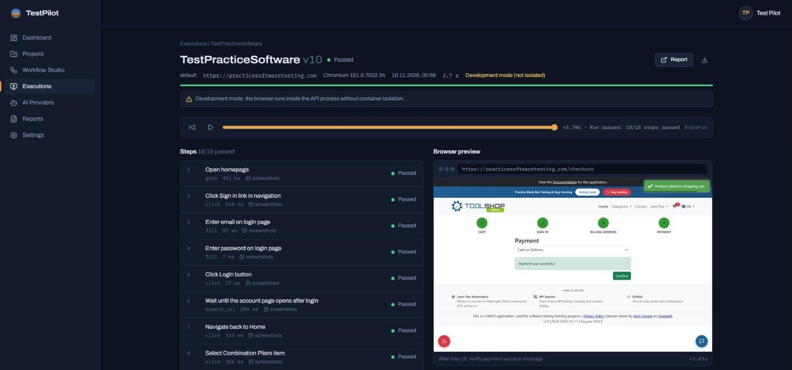
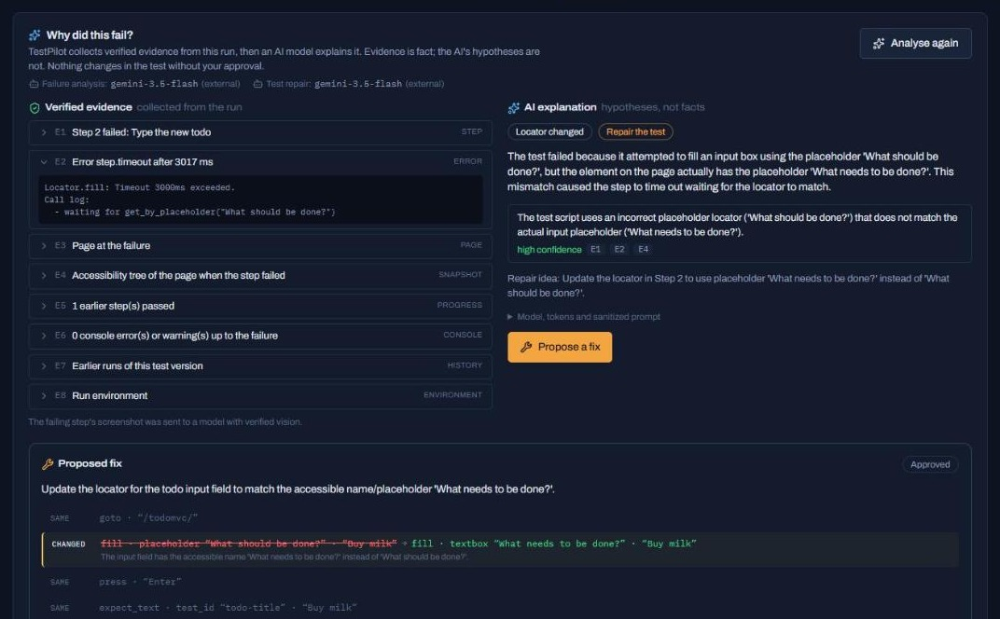
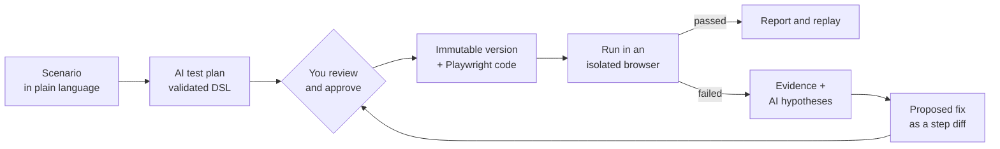
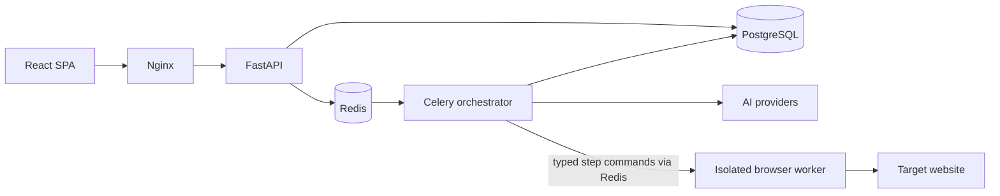

<div align="center">


# TestPilot

**Describe a web test in plain language. Watch it run in a real browser.<br>
When it fails, see the evidence and approve the AI's fix.**

[](https://github.com/AnthonyJVS/TestPilot/actions/workflows/ci.yml)


[Why](#why-testpilot) · [Features](#features) · [How it works](#how-it-works) · [Quick start](#quick-start) · [Architecture](#architecture) · [Docs](#documentation)

</div>

<br>



<p align="center"><sub><b>Execution Center</b>: an 18-step login-and-checkout test against a public demo shop. Every step is recorded and can be replayed with its browser frame.</sub></p>

## Why TestPilot

AI testing tools usually do one of two things: let a model click around on every run (slow,
costly, and different each time), or leave you to hand-write Playwright code. TestPilot splits
the work:

- **AI writes and repairs tests, it does not run them.** A model turns your scenario into a
  validated test plan (a small action DSL). Approved plans run through a controlled Playwright
  adapter: no model in the loop at run time, and model-generated code is never executed.
- **Every run is visible.** Steps stream live with browser frames, and any finished run can be
  scrubbed through from its event log.
- **Failures come with evidence.** TestPilot collects the facts (error, page snapshot,
  screenshot, console, network, history). The AI's explanation has to cite them and is shown as
  a hypothesis, never as a fact.
- **Nothing changes without you.** A fix arrives as a step diff and becomes a new immutable
  version only after you approve it. Rolling back takes one click.
- **Bring your own model.** One Gemini key is enough. Claude, OpenAI and OpenAI-compatible
  providers can be added and routed per task.

## Features

| | |
| --- | --- |
| 🧪 **Testing Workspace** | Projects, environments with encrypted test data and secrets, plain-language scenarios, AI test plans, a plan editor with live validation, approval into immutable versions, exportable Playwright code (Python and TypeScript) |
| 🛡️ **Isolated execution** | Chromium, Firefox and WebKit in a separate worker container with no database access and no credentials; allowed-domain policy with private ranges and cloud metadata blocked; screenshots with secret masking, traces, video, console and network capture |
| 📺 **Execution Center** | Live step timeline and browser preview, replay with a filmstrip, step and node inspector with sanitized AI calls, self-contained HTML reports |
| 🩺 **Failure analysis** | Verified evidence next to AI hypotheses, the failing screenshot for vision models, repairs as step diffs, human approval, rollback |
| 🧩 **Workflow Studio** | Visual node editor with typed ports; a DAG engine with branches, merges, retries, timeouts, error paths and cancellation; browser, test, AI and logic nodes |
| 🤖 **Multi-LLM layer** | Gemini, Claude and OpenAI, plus OpenAI-compatible DeepSeek, Mistral, xAI, OpenRouter, Ollama and LM Studio; one-key Simple mode or per-task routing with fallback, daily limits, a request log and a usage dashboard |
| 🔐 **Accounts and security** | Argon2id passwords, rotating refresh sessions, rate limiting, audit log, AES-256-GCM encrypted provider keys, strict security headers |

<p align="center">
  
  <br>
  <sub><b>Failure analysis</b>: facts collected by TestPilot (left), the model's explanation that cites them (right), and the approved fix as a step diff.</sub>
</p>

## How it works



## Quick start

### With Docker (recommended)

Requires Docker Desktop or Docker Engine with Compose v2.

```bash
cp .env.example .env
```

Fill in `POSTGRES_PASSWORD`, `JWT_SECRET` and `ENCRYPTION_KEYS` in `.env`. Generate the first two with:

```bash
python -c "import secrets; print(secrets.token_urlsafe(48))"
```

and the encryption key with:

```bash
python -c "import os,base64; print('v1:' + base64.urlsafe_b64encode(os.urandom(32)).decode())"
```

Then start the stack:

```bash
docker compose up --build
```

Open <http://localhost:8080>, create an account and add an AI provider key under
**AI Providers** (a free Gemini key is enough). API docs are at <http://localhost:8080/api/docs>.

### Local development (no Docker)

SQLite, an in-memory rate limiter and an in-process browser are used automatically.

```bash
cd backend
python -m venv .venv
.venv/Scripts/python -m pip install -e ".[dev]"      # macOS/Linux: .venv/bin/python
.venv/Scripts/python -m playwright install chromium
.venv/Scripts/alembic upgrade head
.venv/Scripts/python -m uvicorn --factory app.main:app_factory --reload --port 8000
```

In a second terminal:

```bash
cd frontend
npm install
npm run dev
```

Open <http://localhost:5173>. Local runs execute inside the API process without container
isolation, and the UI labels them *Development mode*. To test a site running on your own
machine, set `BROWSER_ALLOW_PRIVATE_NETWORK=true` in `backend/.env`.

> **Windows PowerShell 5.1** does not support `&&`; run the commands one per line as shown.

## Architecture



- The AI produces a validated action DSL that a controlled Playwright adapter executes.
- The browser worker holds no secrets and has no database access; it talks to the orchestrator
  only through typed commands over Redis, on its own networks.
- Every run is a workflow execution with persisted, replayable events. Live updates use
  Server-Sent Events.
- REST API under `/api/v1` with an OpenAPI schema; the frontend's API types are generated from it.

More detail: [ARCHITECTURE.md](docs/ARCHITECTURE.md) ·
[ENGINEERING_DECISIONS.md](docs/ENGINEERING_DECISIONS.md)

## Tech stack

| Layer | Tools |
| --- | --- |
| Backend | Python 3.12+, FastAPI, Pydantic 2, SQLAlchemy 2 (async), Alembic, Celery 5 |
| Data | PostgreSQL 17 (SQLite for local development), Redis 7 |
| Browser | Playwright 1.62: Chromium, Firefox, WebKit |
| Frontend | React 19, TypeScript 5.9, Vite 8, Tailwind CSS 4, TanStack Query 5, Zustand 5, XYFlow 12 |
| AI SDKs | google-genai, anthropic, openai |
| Quality | pytest, Vitest and Testing Library, ruff, mypy (strict), ESLint, GitHub Actions |

## Configuration

Every variable is documented in [.env.example](.env.example). The most important ones:

| Variable | Purpose | Default |
| --- | --- | --- |
| `APP_ENV` | `development`, `test` or `production` (production enforces PostgreSQL, Redis and strong secrets) | `development` |
| `JWT_SECRET` | Token signing key, at least 32 characters | ephemeral in development |
| `ENCRYPTION_KEYS` | AES-256-GCM keys for stored AI provider keys; comma-separated for rotation | local key file in development |
| `EXECUTION_MODE` / `BROWSER_TRANSPORT` | `celery` / `redis` (isolated, required in production) or `inline` / `thread` (development) | `inline` / `thread` |
| `BROWSER_ALLOW_PRIVATE_NETWORK` | Let tests reach localhost and private networks (cloud metadata stays blocked) | `false` |
| `ARTIFACT_RETENTION_DAYS` | Keep screenshots, traces and logs this many days (`0` keeps them forever) | `30` |
| `AI_ALLOW_LOCAL_PROVIDERS` | Allow Ollama and LM Studio on loopback or LAN addresses | on in development, off in production |

Production setup, HTTPS, backups and upgrades: [DEPLOYMENT.md](docs/DEPLOYMENT.md).

## Testing

```bash
cd backend
.venv/Scripts/python -m pytest -q
.venv/Scripts/ruff check .
.venv/Scripts/mypy app browser_worker
```

```bash
cd frontend
npm test
npm run lint
npm run typecheck
npm run build
```

The backend suite has 222 tests, including real Chromium runs against a local fixture site;
the frontend has 34. CI runs the backend suite on both PostgreSQL and SQLite, checks that the
OpenAPI schema and generated types are current, builds the Docker stack, and runs a real test
through the isolated browser worker
([`backend/scripts/smoke_run.py`](backend/scripts/smoke_run.py)).

## Project status

All eight planned milestones are implemented (v1). Known limitations:

- Test plans are generated from the scenario text without looking at the live page, so field
  labels can be guessed wrong on the first run. Failure analysis and repair fix them, but a
  page-aware planner is the main next step.
- There is no built-in unique test data per run yet (for example, a fresh email address for a
  sign-up test).
- The OpenAI-compatible providers (DeepSeek, Mistral, xAI, OpenRouter, Ollama, LM Studio) are
  marked *unverified* until tried with live keys. Azure OpenAI and AWS Bedrock are planned.
- Workflow Studio has no Approval Gate, Switch or data-transform nodes yet; they are shown as
  planned.
- No email verification, password reset or profile editing yet.

Unbuilt features are labelled *Planned* in the UI; nothing is simulated.

## Documentation

| Topic | Document |
| --- | --- |
| System design | [ARCHITECTURE.md](docs/ARCHITECTURE.md) |
| Decisions (ADRs) | [ENGINEERING_DECISIONS.md](docs/ENGINEERING_DECISIONS.md) |
| Test plan format | [TEST_PLAN_DSL.md](docs/TEST_PLAN_DSL.md) |
| Browser execution | [BROWSER_EXECUTION.md](docs/BROWSER_EXECUTION.md) |
| Workflow engine | [WORKFLOW_ENGINE.md](docs/WORKFLOW_ENGINE.md) |
| Execution Center | [EXECUTION_CENTER.md](docs/EXECUTION_CENTER.md) |
| Failure analysis | [FAILURE_ANALYSIS.md](docs/FAILURE_ANALYSIS.md) |
| AI providers | [AI_PROVIDER_INTEGRATION.md](docs/AI_PROVIDER_INTEGRATION.md) |
| Deployment | [DEPLOYMENT.md](docs/DEPLOYMENT.md) |
| Roadmap | [DEVELOPMENT_ROADMAP.md](docs/DEVELOPMENT_ROADMAP.md) |

## Security

Passwords are hashed with Argon2id. Access tokens live 15 minutes in memory; refresh cookies
are `HttpOnly` and `SameSite=Strict`, rotate on use and detect reuse. Provider keys and secret
test data are encrypted at rest, secrets are masked in screenshots and scrubbed from logs,
reports and AI requests. See [SECURITY.md](SECURITY.md).

## Contributing

See [CONTRIBUTING.md](CONTRIBUTING.md).

## License

No open-source license has been chosen yet, so all rights are reserved by the author. Please
ask before reusing the code.
