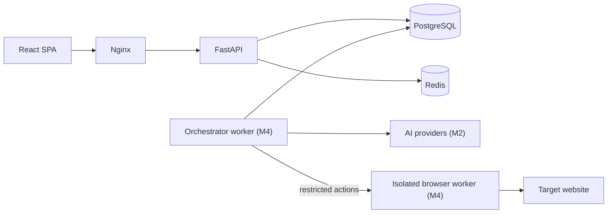

# TestPilot

**AI-assisted autonomous web testing with a visual workflow studio.**

Describe a test in plain language. TestPilot turns it into a structured, reviewable test
plan, executes it in an isolated browser, streams every step live, and explains failures —
using one AI provider (a single Gemini key is enough) or several, routed per task.

> **Project status: Milestone 1 (foundation) of 8.** Authentication, the application shell,
> the dashboard and the Docker stack work today. AI providers, test generation, browser
> execution, Workflow Studio and the Execution Center are designed and scheduled — they are
> labelled *Planned* in the UI and nothing about them is simulated.
> See the [roadmap](docs/DEVELOPMENT_ROADMAP.md).

## Features

| Feature | Status |
| --- | --- |
| Accounts: registration, sign-in, rotating refresh sessions, sign-out, audit log | ✅ Milestone 1 |
| Dashboard with live system status and account activity | ✅ Milestone 1 |
| Dark (default) and light themes, responsive layout | ✅ Milestone 1 |
| Multi-LLM providers: Simple mode (one key) and Advanced per-task routing | Planned — M2 |
| Testing Workspace: projects, scenarios, editable AI test plans, Playwright code | Planned — M3 |
| Isolated browser execution (Chromium, Firefox, WebKit), artifacts, history | Planned — M4 |
| Workflow Studio: n8n-style node editor with DAG execution | Planned — M5 |
| Execution Center: live canvas, timeline, node inspector, browser preview | Planned — M6 |
| Failure analysis and human-approved repairs | Planned — M7 |
| HTML reports, AI usage dashboard, more providers | Planned — M8 |

## Architecture



Key decisions: AI produces a validated action DSL that a controlled Playwright adapter
executes — model-generated code is never run; the browser worker holds no secrets and no
database access; every run is a workflow execution with persisted, replayable events.
Details: [ARCHITECTURE.md](docs/ARCHITECTURE.md) ·
[ENGINEERING_DECISIONS.md](docs/ENGINEERING_DECISIONS.md) ·
[WORKFLOW_ENGINE.md](docs/WORKFLOW_ENGINE.md) ·
[EXECUTION_CENTER.md](docs/EXECUTION_CENTER.md) ·
[AI_PROVIDER_INTEGRATION.md](docs/AI_PROVIDER_INTEGRATION.md)

## Tech stack

- **Backend:** Python 3.12+ (images use 3.13), FastAPI, Pydantic 2, SQLAlchemy 2 (async),
  Alembic, PostgreSQL 17, Redis 7, Argon2id, PyJWT. Celery arrives with browser execution.
- **Frontend:** React 19, TypeScript 5.9, Vite 8, Tailwind CSS 4, shadcn/ui patterns on
  Radix, TanStack Query 5, React Router 8, Zustand 5. XYFlow and Recharts arrive with the
  studio and usage dashboard.
- **Tooling:** pytest, Vitest + React Testing Library, ruff, mypy (strict), ESLint, Docker
  Compose, GitHub Actions.

## Quick start with Docker

Requires Docker Desktop (Windows/macOS) or Docker Engine with Compose v2.

```bash
cp .env.example .env
```

Edit `.env` and set `POSTGRES_PASSWORD` and `JWT_SECRET`. Generate values with:

```bash
python -c "import secrets; print(secrets.token_urlsafe(48))"
```

```bash
docker compose up --build
```

Open <http://localhost:8080> and create an account. API docs: <http://localhost:8080/api/docs>.

The stack runs `postgres`, `redis`, a one-shot `migrate` job (Alembic), `backend` and
`frontend` (Nginx). Only port 8080 is published; PostgreSQL and Redis sit on an internal
network with no internet access.

## Local development without Docker

**Backend** (SQLite and an in-memory rate limiter are used when PostgreSQL/Redis are absent):

```bash
cd backend
python -m venv .venv
.venv/Scripts/activate        # Windows; use `source .venv/bin/activate` on macOS/Linux
pip install -e ".[dev]"
alembic upgrade head
uvicorn --factory app.main:app_factory --reload --port 8000
```

**Frontend** (Vite proxies `/api` to `127.0.0.1:8000`, so cookies stay same-origin):

```bash
cd frontend
npm install
npm run dev
```

Open <http://localhost:5173>.

## Environment variables

All variables are documented in [.env.example](.env.example). The important ones:

| Variable | Purpose | Default |
| --- | --- | --- |
| `APP_ENV` | `development`, `test` or `production` (production enforces PostgreSQL, Redis and a strong `JWT_SECRET`) | `development` |
| `DATABASE_URL` | SQLAlchemy async URL | SQLite file in `backend/data/` |
| `REDIS_URL` | Redis for rate limiting (and queues from M4) | unset (in-memory, dev only) |
| `JWT_SECRET` | HS256 signing key, ≥ 32 characters | ephemeral in development |
| `COOKIE_SECURE` | Send the refresh cookie only over HTTPS | `true` (compose: `false` for localhost) |
| `ALLOW_REGISTRATION` | Allow self-service sign-up | `true` |
| `ENABLE_API_DOCS` | Serve Swagger UI at `/api/docs` | `true` |

## Database

Schema changes go through Alembic migrations in `backend/alembic/versions`. A test
(`test_models_and_migrations_are_in_sync`) fails if models and migrations drift.

```bash
cd backend
alembic upgrade head                              # apply
alembic revision --autogenerate -m "describe change"   # create, then review the file
```

## API

REST under `/api/v1`, documented by OpenAPI (`/api/docs`). Every error uses one envelope:
`{"error": {"code", "message", "request_id", "details"}}`. Frontend types are generated
from the schema:

```bash
cd backend && python scripts/export_openapi.py
```

```bash
cd frontend && npm run gen:api
```

## Tests

```bash
cd backend && pytest -q && ruff check . && mypy app
```

```bash
cd frontend && npm test && npm run lint && npm run typecheck && npm run build
```

Set `TEST_DATABASE_URL` to run the backend suite against PostgreSQL (CI does both).

## Security

Argon2id passwords, 15-minute in-memory access tokens, `HttpOnly`/`SameSite=Strict`
refresh cookies with rotation and reuse detection, login rate limiting, audit logging,
secret redaction in logs, strict security headers. See [SECURITY.md](SECURITY.md).

## Known limitations (Milestone 1)

- The Docker stack and PostgreSQL path are verified by CI, not yet on the original
  development machine (Docker was not installed there); local runs used SQLite.
- Profile editing, password change and session management UI are not built yet.
- The frontend bundle is a single chunk (~660 kB); route-level code splitting comes with
  the Workflow Studio.
- No email verification or password reset flow yet.

## Contributing

See [CONTRIBUTING.md](CONTRIBUTING.md).
