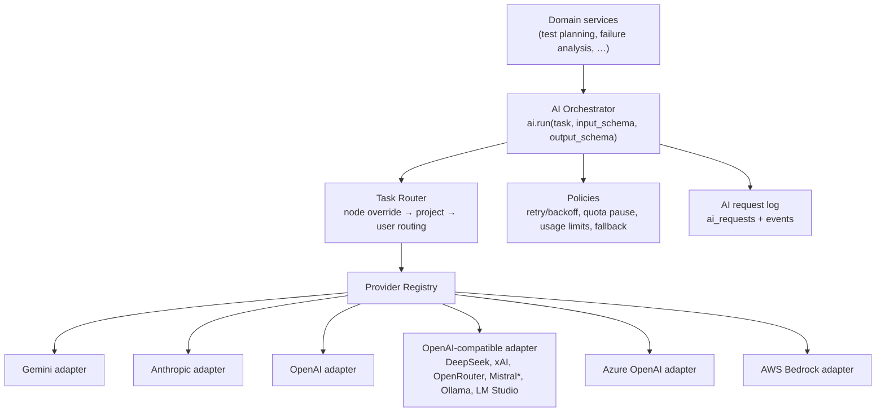

# AI Provider Integration

> Status: **Design** — delivered in Milestone 2. Provider APIs, SDK versions,
> model IDs and capabilities will be verified against current official
> documentation at implementation time; nothing below is a claim of support
> until the adapter has been tested and this document updated.

## 1. Layers



`*` Each provider gets its own registry entry and is verified separately even
when it shares the OpenAI-compatible transport.

## 2. Adapter contract

```python
class AIProvider(Protocol):
    type_id: str                      # "gemini", "anthropic", ...
    async def validate_connection(self) -> ConnectionResult: ...
    async def list_models(self) -> list[ModelInfo]: ...          # may raise NotSupported
    def capabilities(self, model_id: str) -> ModelCapabilities: ...
    async def generate(self, req: GenerateRequest) -> GenerateResponse: ...
    async def generate_structured(self, req: StructuredRequest[T]) -> StructuredResponse[T]: ...
```

Task-level helpers (`generate_test_plan`, `generate_test_code`,
`analyze_failure`, `propose_repair`, `analyze_visual`, `generate_report`) live
in the orchestrator and are built on `generate_structured`, so adapters stay
small and provider details never leak into domain services.

`GenerateResponse` always carries: actual model ID, provider request ID (if
returned), token usage (if returned), latency, finish reason, raw-response
hash. Errors are normalised to `AuthError` (permanent), `PermissionError`
(permanent), `InvalidRequestError` (permanent), `RateLimitError` (transient,
with `retry_after`), `QuotaExhaustedError` (pause), `ProviderUnavailableError`
(transient), `ContentFilteredError`.

## 3. Modes

- **Simple Mode** — one connection + one model used for every task. A single
  Gemini key is enough when the chosen model supports the needed
  capabilities (vision is only required for Visual Analysis).
- **Advanced Mode** — a route per task category (requirement analysis, test
  planning, code generation, failure analysis, visual analysis, test repair,
  report generation). Unset tasks fall back to the Simple Mode default.
- **Custom Workflow Mode** — AI nodes may set provider/model explicitly;
  this overrides project/user routing after validation.

Before a run, the router checks that each resolved model has the required
capabilities and reports gaps (e.g. "Visual Analysis needs image input").

## 4. Model catalog

Models are discovered through each provider's listing API where available,
otherwise entered manually. Capabilities (text, structured output, vision,
tool calling, context window) come from provider metadata where it exists;
when unknown they are stored as `unknown`, never assumed. Model IDs are data,
never constants in code.

## 5. Quotas, retries, fallback

- 429/`RESOURCE_EXHAUSTED`: honour `Retry-After`, exponential backoff with
  jitter, max 3 attempts. If the quota is exhausted (daily limits), the task
  is **paused** with a clear message and a "Retry" action; nothing switches
  silently.
- Fallback is **off by default**. When enabled, it applies only to transient
  errors and quota exhaustion, never to auth/permission/invalid-request
  errors. Every fallback records requested vs actual model, reason, original
  error and retry history, and emits an `ai.fallback.applied` event.
- Optional user usage limits (requests/tokens per day) pause AI work when
  reached.

## 6. Data sent to providers

Prompts contain: scenario text, test plan structure, sanitized page
excerpts/DOM summaries, error messages and (for visual analysis) screenshots.
They never contain API keys, stored secrets (only `{{secret.NAME}}`
references), cookies or auth tokens. The UI labels each call as external or
local and links to this list. Page content is wrapped as untrusted data and
the model is instructed to ignore instructions found in it.

## 7. Credential storage

AES-256-GCM with a master key from the environment
(`TESTPILOT_ENCRYPTION_KEYS`, versioned to allow rotation). Ciphertext, nonce
and key version are stored in `ai_credentials`; keys are write-only through
the API and decrypted only in the orchestrator immediately before a call.
