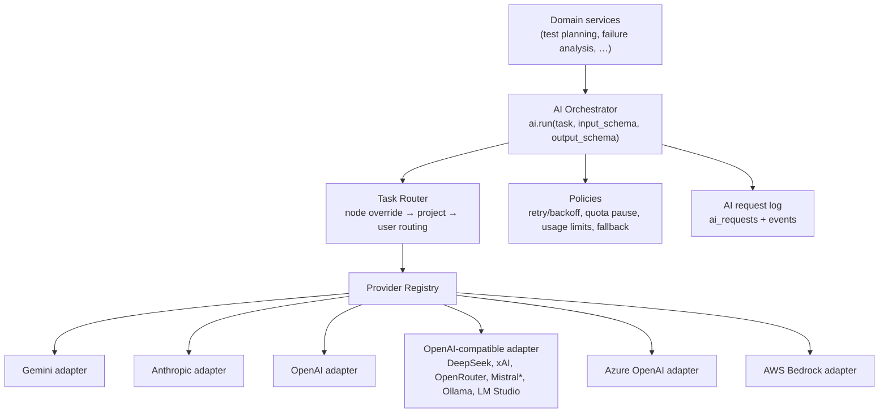

# AI Provider Integration

> Status: **Implemented (Milestone 2)** for Google Gemini, Anthropic Claude and
> OpenAI. The other eight providers are listed in the catalog as *planned*
> (milestone 8) and cannot be selected.

## 0. Implementation status and verification

| Provider | SDK (pinned) | Adapter | Mock-HTTP tests | Live check |
| --- | --- | --- | --- | --- |
| Google Gemini | `google-genai==3.0.0` | `services/ai/providers/gemini.py` | request format, model listing, quota vs rate-limit vs auth vs 5xx mapping, safety blocks | Invalid key → *"Gemini rejected the API key"* against the live API (2026-11-08). A positive run with a real key is pending. |
| Anthropic Claude | `anthropic==2.6.0` | `.../anthropic.py` | `output_config` structured output, image blocks, capability metadata, 401/429/529 mapping | Invalid key → auth error against the live API (2026-11-08). |
| OpenAI | `openai==3.46.0` | `.../openai.py` | `response_format=json_schema`, data-URL images, non-chat model filtering, quota vs rate-limit mapping | Invalid key → auth error against the live API (2026-11-08). |

Facts verified against the installed SDK source (not assumed):

- All three SDKs now use **`httpx2`**; tests inject `httpx2.MockTransport`.
- Gemini: `GenerateContentConfig.response_json_schema` accepts raw JSON
  Schema; inline image fields serialise as `inlineData.mime_type`; `models.list`
  returns `supported_actions` and token limits but **no modality information**,
  so vision is `unknown` until a routing check proves it.
- Anthropic 2.x sends the key as `Authorization: Bearer`; native structured
  output is `output_config={"format": {"type": "json_schema", "schema": …}}`;
  `models.list` reports `capabilities.image_input` and
  `capabilities.structured_outputs`, which TestPilot stores as provider
  metadata. `EnforcedSpendLimitReachedError` is a `RateLimitError` subclass and is
  mapped to quota exhaustion.
- OpenAI: `models.list` has no capability data; embedding/speech/image models
  are hidden from the picker (any ID can still be added manually).
- SDK-level retries are disabled (`max_retries=0` / one attempt) so the
  orchestrator owns and records every attempt.

## 1. Layers



`*` Each provider gets its own registry entry and is verified separately even
when it shares the OpenAI-compatible transport.

## 2. Adapter contract

```python
class AIProvider(Protocol):
    type_id: str                      # "gemini", "anthropic", ...
    async def validate_connection(self) -> ConnectionResult: ...
    async def list_models(self) -> list[ModelInfo]: ...          # may raise NotSupported
    def capabilities(self, model_id: str) -> ModelCapabilities: ...
    async def generate(self, req: GenerateRequest) -> GenerateResponse: ...
    async def generate_structured(self, req: StructuredRequest[T]) -> StructuredResponse[T]: ...
```

Task-level helpers (`generate_test_plan`, `generate_test_code`,
`analyze_failure`, `propose_repair`, `analyze_visual`, `generate_report`) live
in the orchestrator and are built on `generate_structured`, so adapters stay
small and provider details never leak into domain services.

`GenerateResponse` always carries: actual model ID, provider request ID (if
returned), token usage (if returned), latency, finish reason, raw-response
hash. Errors are normalised to `AuthError` (permanent), `PermissionError`
(permanent), `InvalidRequestError` (permanent), `RateLimitError` (transient,
with `retry_after`), `QuotaExhaustedError` (pause), `ProviderUnavailableError`
(transient), `ContentFilteredError`.

## 3. Modes

- **Simple Mode** — one connection + one model used for every task. A single
  Gemini key is enough when the chosen model supports the needed
  capabilities (vision is only required for Visual Analysis).
- **Advanced Mode** — a route per task category (requirement analysis, test
  planning, code generation, failure analysis, visual analysis, test repair,
  report generation). Unset tasks fall back to the Simple Mode default.
- **Custom Workflow Mode** — AI nodes may set provider/model explicitly;
  this overrides project/user routing after validation.

Before a run, the router checks that each resolved model has the required
capabilities and reports gaps (e.g. "Visual Analysis needs image input").
Capabilities marked *unsupported* block the route; *unknown* ones produce a
warning.

### Routing check

`POST /api/v1/ai/routing/check/{task}` makes one small, real structured call for
the task's route (a requirement list, a two-step plan, a Playwright line, a
failure category, the colour of a generated red PNG, a repaired locator, a
one-line summary) and verifies the answer in Python. Results are recorded in
`ai_requests` and become capability evidence (`source: "probe"`): text,
native structured output and — via the image check — vision. The UI runs the
checks sequentially to stay inside free-tier per-minute limits.

## 4. Model catalog

Models are discovered through each provider's listing API where available,
otherwise entered manually. Capabilities (text, structured output, vision,
tool calling, context window) come from provider metadata where it exists;
when unknown they are stored as `unknown`, never assumed. Model IDs are data,
never constants in code.

## 5. Quotas, retries, fallback

- 429/`RESOURCE_EXHAUSTED`: honour `Retry-After`, exponential backoff with
  jitter, max 3 attempts. If the quota is exhausted (daily limits), the task
  is **paused** with a clear message and a "Retry" action; nothing switches
  silently.
- Fallback is **off by default**. When enabled, it applies only to transient
  errors and quota exhaustion, never to auth/permission/invalid-request
  errors. Every fallback records requested vs actual model, reason, original
  error and retry history, and emits an `ai.fallback.applied` event.
- Optional user usage limits (requests/tokens per day) pause AI work when
  reached.

## 6. Data sent to providers

Prompts contain: scenario text, test plan structure, sanitized page
excerpts/DOM summaries, error messages and (for visual analysis) screenshots.
They never contain API keys, stored secrets (only `{{secret.NAME}}`
references), cookies or auth tokens. The UI labels each call as external or
local and links to this list. Page content is wrapped as untrusted data and
the model is instructed to ignore instructions found in it.

## 7. Credential storage

AES-256-GCM (`app/core/crypto.py`) with versioned keys from `ENCRYPTION_KEYS`
(`v2:<key>,v1:<key>` — the first encrypts, all decrypt). Associated data binds
each ciphertext to its connection row (`ai_provider:<id>`), so a ciphertext
copied to another row fails authentication. Ciphertext, nonce and key ID are
stored in `ai_credentials` with a 4-character hint; keys are write-only through
the API and decrypted only when a provider client is built for a call.
Development without `ENCRYPTION_KEYS` uses a generated key file in
`backend/data/`; production refuses to start without the variable.

Custom endpoint URLs (OpenAI-compatible base URL) must be HTTPS, contain no
credentials and resolve only to public addresses (SSRF protection).

## 8. API

| Endpoint | Purpose |
| --- | --- |
| `GET /ai/provider-types` | Catalog with availability, data location (external/local), key help link |
| `GET/POST /ai/providers`, `GET/PATCH/DELETE /ai/providers/{id}` | Connections (key write-only) |
| `PUT/DELETE /ai/providers/{id}/credential` | Rotate or delete the key |
| `POST /ai/providers/{id}/test` | List models (no generation quota), refresh catalog, update status |
| `POST /ai/providers/{id}/models`, `DELETE /ai/models/{id}` | Manual model IDs |
| `GET/PUT /ai/routing` | Mode, default, per-task routes, fallback, daily limit, payload previews; effective route per task with issues/warnings |
| `POST /ai/routing/check/{task}` | Real minimal call for one task |
| `GET /ai/requests` | AI request log (requested vs actual model, attempts, tokens, latency, sanitized payloads) |
