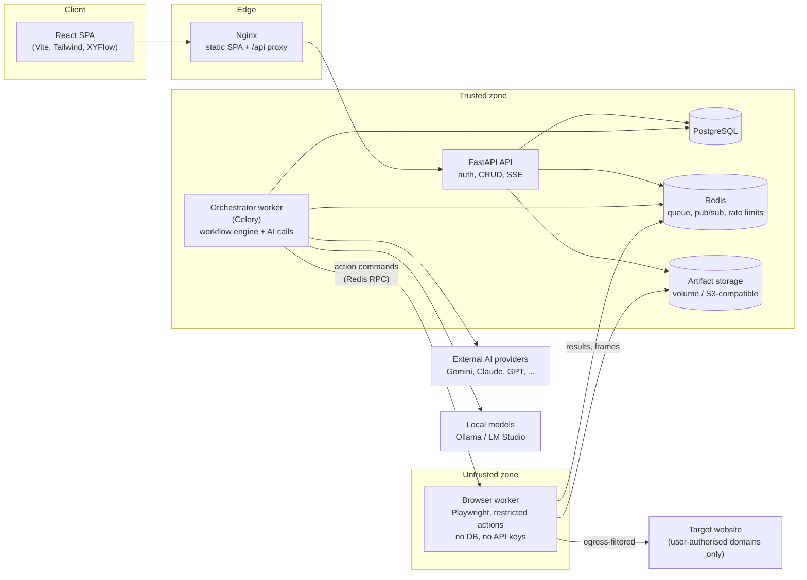
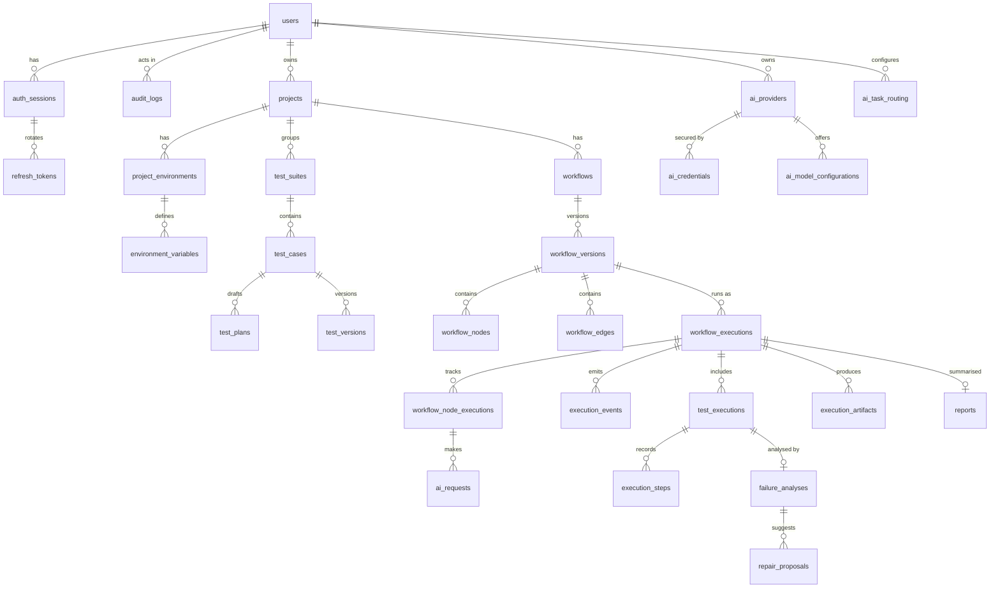

# TestPilot — Architecture

> Status legend used throughout the docs: **Implemented** (built and verified),
> **Design** (agreed design, not yet built). Each section names the milestone
> that delivers it. See [DEVELOPMENT_ROADMAP.md](DEVELOPMENT_ROADMAP.md).

| Area | Status |
| --- | --- |
| Backend foundation, auth, migrations, health, audit log | Implemented (M1) |
| Frontend shell, navigation, auth pages, dashboard | Implemented (M1) |
| Docker Compose (postgres, redis, backend, frontend) | Implemented (M1), Docker run pending verification on a Docker host |
| Multi-LLM layer: Gemini, Claude, OpenAI adapters, encryption, routing, request log, AI Providers page | Implemented (M2); positive live call pending a real API key |
| Additional providers | Implemented (M8) for DeepSeek, Mistral, xAI, OpenRouter, Ollama, LM Studio via OpenAI-compatible adapters, marked *unverified* (mock-HTTP tested, no live key); Azure OpenAI and AWS Bedrock planned after v1 |
| Testing Workspace: projects, environments, encrypted test data, suites, tests, AI plan generation, plan editor, approval, versions, Playwright code | Implemented (M3); AI generation verified with test doubles, live run pending a real API key |
| Browser execution: isolated browser worker, Celery orchestrator, events + SSE, artifacts, run view, history | Implemented (M4); verified locally in development mode (real Chromium), Docker path verified by the CI smoke run — see [BROWSER_EXECUTION.md](BROWSER_EXECUTION.md) |
| Workflow Studio + DAG engine | Implemented (M5); engine verified with real Chromium and fake AI providers, live run of the Run-a-test template on demo.playwright.dev |
| Execution Center + Browser Preview | Implemented (M6): live frames, replay, inspector; verified with real Chromium and in the UI |
| Failure analysis and repair | Implemented (M7): evidence collection, AI analysis, validated repair proposals, approval, rollback, Failure Analyzer node — see [FAILURE_ANALYSIS.md](FAILURE_ANALYSIS.md) |
| Reports, usage dashboard, retention, deployment guide | Implemented (M8); see [DEPLOYMENT.md](DEPLOYMENT.md) |

---

## 1. Architecture proposal

TestPilot is a modular monolith API plus two kinds of background workers,
separated by a hard security boundary around the browser.



Key principles:

1. **The browser is untrusted.** The browser worker runs in its own container,
   has no database access and never sees AI provider keys. It only accepts a
   closed set of validated action commands over Redis and writes artifacts.
2. **Models never produce executable code that we run.** AI produces a
   structured, schema-validated *test plan* written in a restricted action DSL.
   TestPilot executes the DSL through a controlled Playwright adapter. The
   Playwright test code shown to users is rendered *deterministically* from
   the same DSL, so the code a user reviews is exactly what runs.
   See ADR-004 in [ENGINEERING_DECISIONS.md](ENGINEERING_DECISIONS.md).
3. **Everything is an execution.** "Run Test" in the Testing Workspace launches
   a built-in workflow template, so every run (single test or custom workflow)
   is visible in the Execution Center with the same canvas, timeline,
   inspector and browser preview.
4. **Events are the source of truth for live and historical views.** The
   orchestrator persists every execution event to PostgreSQL first, then
   publishes it to Redis. The API streams events to the browser over
   Server-Sent Events and replays from the database after refresh/reconnect.
5. **Provider-agnostic AI.** Domain services request an AI *task*
   (e.g. `test_planning`). The AI router resolves the provider/model from the
   workflow node, project or user routing configuration and records the
   requested vs. actual model of every call.

## 2. Component boundaries

### Backend (`backend/app`)

| Package | Responsibility | Depends on |
| --- | --- | --- |
| `api/routes` | HTTP contract only: parse, authorise, call a service, map to schema | `services`, `schemas`, `api/dependencies` |
| `api/dependencies` | DB session, current user, pagination, rate limiting | `core`, `infrastructure` |
| `core` | Settings, password hashing, JWT, redaction, logging, error types | stdlib + small libs only |
| `schemas` | Pydantic request/response models (the public API contract) | `core` |
| `domain` | Domain exceptions, enums, value objects (no I/O) | nothing |
| `services` | Use cases: auth, projects, test generation, workflows, AI orchestration | `domain`, `infrastructure` interfaces |
| `services/ai` | Provider adapters, registry, model catalog, task router (M2) | provider SDKs |
| `services/workflows` | Validator, compiler, scheduler, executor (M5) | node registry |
| `infrastructure/database` | SQLAlchemy models, engine/session | SQLAlchemy |
| `infrastructure/repositories` | Query objects with mandatory ownership filters | database |
| `infrastructure/cache` | Redis client, rate limiter | redis |
| `infrastructure/browser` | Browser worker RPC client + action DSL (M4) | redis |
| `workers` | Celery app and tasks (M4) | services |

Rules: routes never touch the ORM directly; services never import FastAPI;
provider SDK types never leave `services/ai/providers`.

### Browser worker (`browser_worker/`, M4)

A separate Python package and container image based on the official
Playwright image. It consumes commands such as `session.open`, `page.goto`,
`locator.click`, `locator.fill`, `expect.visible`, `page.screenshot`,
`session.close`. Each command is validated against a Pydantic schema; there is
no `eval`, no arbitrary JS, no shell. It enforces URL policy (allowed domains,
blocked private ranges) on every request via Playwright request interception
and DNS validation.

### Frontend (`frontend/src`)

| Folder | Responsibility |
| --- | --- |
| `app/` | Router, providers (query client, theme), app shell |
| `components/ui` | shadcn/ui primitives (owned source) |
| `components/layout`, `components/common` | Shell, sidebar, empty/planned/error states |
| `features/<area>` | Feature modules: `auth`, `dashboard`, `projects`, `ai-providers`, `workflow-studio`, `executions`, `browser-preview`, `reports`, `settings` |
| `lib/` | API client (token refresh, error envelope), utilities |
| `stores/` | Zustand stores for client-only state (auth token in memory, theme) |
| `types/` | Types generated from the backend OpenAPI schema |

Server state lives in TanStack Query; Zustand is only for client state
(auth session, theme, canvas UI state).

## 3. Database design

PostgreSQL is the system of record. All primary keys are UUIDs. All
user-owned rows carry `owner_id` (directly or through their parent project),
and repositories always filter by it. Timestamps are `timestamptz` (UTC).
Large JSON documents (plans, node configs, payloads) use `JSONB`.

Tables (milestone of introduction in brackets):

| Group | Tables |
| --- | --- |
| Identity [M1] | `users`, `auth_sessions` (one per login: a refresh-token family), `refresh_tokens` (SHA-256 hashes in the rotation chain), `audit_logs` |
| AI [M2] | `ai_providers` (a user's provider connection), `ai_credentials` (encrypted secret, key version, rotation), `ai_model_configurations` (discovered or manual model IDs with capabilities), `ai_task_routing` (mode, per-task routes, fallback policy), `ai_requests` (one row per AI call: task, requested/actual model, latency, tokens, request ID, status, retry/fallback history) |
| Projects [M3] | `projects`, `project_environments`, `environment_variables` (secret values encrypted, write-only) |
| Tests [M3] | `test_suites`, `test_cases`, `test_plans` (AI/user drafts with requirement analysis), `test_versions` (immutable approved versions: DSL steps + rendered code + parent version) |
| Workflows [M5] | `workflows`, `workflow_versions` (immutable; the graph is one validated JSON document, ADR-019), `workflow_node_executions` |
| Executions [M4 implemented, M5 adds workflow runs] | `workflow_executions` (pinned to a workflow version + resolved config snapshot), `workflow_node_executions`, `execution_events` (ordered by per-execution `seq`), `test_executions`, `execution_steps`, `execution_artifacts` |
| Quality [M7/M8] | `failure_analyses`, `repair_proposals`, `reports` |

Additions to the brief and why: `auth_sessions` + `refresh_tokens` (revocable
sessions with refresh-token rotation and reuse detection), `environment_variables` (test data and secrets kept out
of plans and AI prompts), `ai_requests` (required for transparency, usage and
cost reporting).



Indexes: every foreign key; `(owner_id, created_at)` on listing tables
(M1: `audit_logs (user_id, created_at)`); unique `refresh_tokens.token_hash`;
`(execution_id, seq)` unique on `execution_events`; `(status, created_at)` on
executions for dashboards.

Local development without Docker may use SQLite (see ADR-003); the schema and
migrations are written with portable SQLAlchemy types for that reason, and CI
runs the test suite against PostgreSQL.

## 4. API contract outline

REST + JSON under `/api/v1`, documented by FastAPI's OpenAPI schema
(`/api/docs`). Frontend types are generated from that schema
(`npm run gen:api`) so contracts cannot drift silently.

Conventions: cursor pagination (`limit`, `cursor`), UTC ISO-8601 timestamps,
and one error envelope for every failure:

```json
{ "error": { "code": "auth.invalid_credentials", "message": "Invalid email or password.", "request_id": "…", "details": null } }
```

| Area | Endpoints | Milestone |
| --- | --- | --- |
| Health | `GET /health/live`, `GET /health/ready` (outside `/api/v1`) | M1 |
| Auth | `POST /auth/register`, `POST /auth/login`, `POST /auth/refresh`, `POST /auth/logout`, `GET /auth/me` | M1 |
| System | `GET /system/status` (authenticated, real dependency checks) | M1 |
| Audit | `GET /audit-logs` (own events) | M1 |
| AI providers | `GET /ai/provider-types`, `GET/POST/PATCH/DELETE /ai/providers`, `PUT /ai/providers/{id}/credential`, `POST /ai/providers/{id}/test`, `GET /ai/providers/{id}/models`, `POST /ai/providers/{id}/models` (manual ID), `GET/PUT /ai/routing`, `GET /ai/usage` | M2 |
| Projects | `GET/POST/PATCH/DELETE /projects`, `…/projects/{id}/environments`, `…/environments/{id}/variables` (secret values write-only) | M3 |
| Tests | `…/projects/{id}/suites`, `…/suites/{id}/cases`, `POST /cases/{id}/plans/generate`, `GET/PATCH /plans/{id}`, `POST /plans/{id}/approve`, `GET /cases/{id}/versions`, `POST /versions/{id}/run` | M3/M4 |
| Workflows | `GET /workflow-node-types`, `GET/POST/PATCH /workflows`, `POST /workflows/{id}/versions`, `POST /workflows/{id}/duplicate`, `POST /workflows/{id}/validate`, `POST /workflows/{id}/run` | M5 |
| Executions | `GET /executions`, `GET /executions/{id}`, `GET /executions/{id}/nodes`, `GET /executions/{id}/events`, `GET /executions/{id}/events/stream` (SSE), `POST /executions/{id}/cancel`, `POST /executions/{id}/approvals/{node_id}` | M4–M6 |
| Artifacts | `GET /artifacts/{id}`, `GET /artifacts/{id}/content` (ownership-checked, never static) | M4 |
| Quality | `GET /executions/{id}/failure-analysis`, `POST /repair-proposals/{id}/approve`, `…/reject`, `POST /versions/{id}/rollback`, `POST /executions/{id}/report`, `GET /reports/{id}` | M7/M8 |

Long-running operations (plan generation, runs) return `202` with an
execution ID immediately; progress arrives through the event stream.

## 5. Workflow execution design (summary)

Full design: [WORKFLOW_ENGINE.md](WORKFLOW_ENGINE.md).

- Definitions (`workflows`) are separate from immutable `workflow_versions`.
  An execution pins a version and stores a resolved-configuration snapshot
  (including the AI routing that was in force), so editing never changes an
  active or historical run.
- Every node type is registered in the backend with a stable ID
  (e.g. `browser.navigate`), a JSON-schema config, typed input/output ports,
  validation rules, an executor and documented error behaviour. The frontend
  palette and inspector forms are generated from `GET /workflow-node-types`.
  Planned node types are returned with `available: false` and cannot be
  placed on the canvas.
- The engine validates a DAG (no cycles), schedules nodes as their inputs
  resolve, runs independent branches concurrently, and applies per-node retry
  and timeout policies. Conditions/switches deactivate untaken edges; nodes
  whose inputs are all inactive become `skipped`. Failures follow an `error`
  handle if connected, otherwise fail the run and cancel/skip the rest.
- Node states: `waiting`, `queued`, `running`, `completed`, `failed`,
  `skipped`, `cancelled`.

## 6. Security risks and mitigations

| # | Risk | Mitigation | Milestone |
| --- | --- | --- | --- |
| S1 | Credential theft (passwords, tokens) | Argon2id hashing; 15-min JWT access tokens kept in memory; refresh tokens only in `HttpOnly`, `SameSite=Strict` cookies, hashed at rest, rotated on every use, family revoked on reuse; login rate limiting; audit log | M1 |
| S2 | CSRF on cookie endpoints | Cookie scoped to `/api/v1/auth`, `SameSite=Strict`, plus mandatory custom header on refresh/logout (forces CORS preflight) | M1 |
| S3 | AI key leakage | Keys encrypted at rest (AES-GCM, versioned master key from env), write-only API, never returned, never logged, only decrypted inside the orchestrator at call time | M2 |
| S4 | Secrets sent to AI providers | Test data referenced as `{{env.NAME}}` / `{{secret.NAME}}`; only names reach prompts; values injected into browser commands at execution time; redaction before persistence/display | M2–M4 |
| S5 | Executing model-generated code | AI emits a restricted action DSL validated by Pydantic; no `eval`, no shell, no arbitrary JS; rendered code is display/export only | M3–M4 |
| S6 | SSRF through the browser | Per-project allowed domains; block loopback, RFC1918, link-local, CGNAT, IPv6 ULA and cloud metadata (169.254.169.254, fd00:ec2::254); DNS resolution check and redirect re-validation on every request via route interception; network-level egress isolation for the worker container | M4 (implemented; link-local/metadata blocked even when private targets are allowed) |
| S7 | Browser exploit escaping | Worker container: non-root, read-only root FS, no Docker socket, no host mounts, CPU/memory/pids limits, per-run timeouts, fresh browser context per run, no DB/secrets; Redis reachable only over a dedicated network without PostgreSQL | M4 (implemented in compose) |
| S8 | Prompt injection from target pages | Page content always wrapped as untrusted data in prompts; AI outputs constrained to schemas; AI cannot trigger actions outside the DSL; destructive steps need an Approval Gate | M3–M7 |
| S9 | Cross-tenant data access | Ownership filter inside every repository query; artifacts served only through authorised endpoints; tests for IDOR on each resource | M1+ |
| S10 | Sensitive data in logs/events | Central redaction (key-based and pattern-based) applied to logs, events and AI payload previews; configurable data-minimisation settings | M1/M2/M6 |
| S11 | Abuse / cost blow-up | API rate limits, user-configured AI usage limits that pause work, bounded retries, no silent provider fallback | M2/M8 |
| S12 | Misleading privacy claims | UI labels every AI call as *external provider* or *local model* and lists the data categories sent | M2/M6 |

## 7. Milestone plan

See [DEVELOPMENT_ROADMAP.md](DEVELOPMENT_ROADMAP.md).
