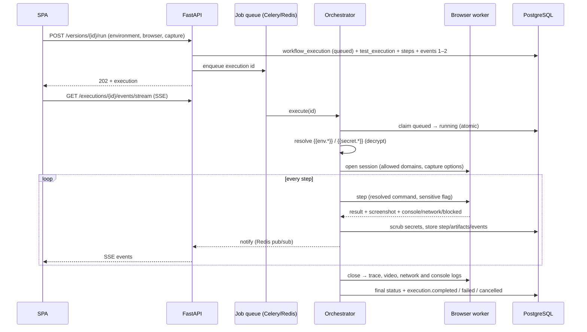

# Browser Execution

> Status: **Implemented** (Milestone 4). Verified with real Chromium locally in development
> mode (API integration tests and a live run against demo.playwright.dev). The Docker path
> (Celery worker + isolated browser-worker container) is exercised by the CI smoke run
> (`backend/scripts/smoke_run.py`).

## 1. Flow

Every run is a workflow execution (ADR-010) of the built-in template
`launch_browser → execute_test → collect_artifacts`; events carry those node IDs so the
Milestone 5/6 canvas can draw the same run.

## 2. Components

| Component | Code | Has DB access | Has secrets | Runs browsers |
| --- | --- | --- | --- | --- |
| API | `app/api/routes/executions.py`, `app/services/execution/execution_service.py` | yes | no (names only) | no |
| Orchestrator | `app/services/execution/orchestrator.py` (Celery task in `app/worker.py`) | yes | decrypts test data at run time | no |
| Browser worker | `browser_worker/` (`python -m browser_worker`) | **no** | only resolved values of the current step | yes |

The browser worker package never imports `app` (enforced by a test) and its image contains
only Playwright, Pydantic and Redis.

## 3. Deployment modes (ADR-017)

| Setting | Development default | Docker / production |
| --- | --- | --- |
| `EXECUTION_MODE` | `inline` — asyncio task in the API process | `celery` — `worker` service |
| `BROWSER_TRANSPORT` | `thread` — engine on a thread of the API process | `redis` — `browser-worker` container |
| Isolation | none (labelled "Development mode" in the UI) | container: non-root, read-only root FS, all capabilities dropped, `no-new-privileges`, 2 GB / 2 CPU / 512 pids, own networks |

Local development needs the browser once: `python -m playwright install chromium`.

## 4. Worker protocol

Typed Pydantic messages (`browser_worker/protocol.py`): `info`, `open`, `step`, `close`.
Over Redis, `info`/`open` go to the shared `bw:requests` queue (taken by any worker with
free capacity); `step`/`close` go to `bw:worker:<id>` of the worker that owns the session.
Replies go to a per-request `bw:reply:<id>` list with a TTL; expired requests are dropped.

## 5. Step semantics

The engine mirrors the code renderer exactly (`goto` relative to the environment URL,
`get_by_role/label/text/placeholder/test_id` locators, strict mode, `to_contain_text` vs
`to_have_text`, regex-escaped `contains` for URL/title). Action timeout defaults to 10 s,
navigation to 30 s, assertions to Playwright's 5 s; a step's `timeout_ms` overrides them.
Assertion failures are reported as "Expected … " plus Playwright's own detail.

Result statuses: run `passed` / `failed` (the application or test failed) / `error`
(infrastructure: browser missing, worker timeout, missing test data) / `cancelled`.

## 6. Network policy (every request, via route interception)

- Only `http`/`https` leave the browser; `data:`, `blob:`, `about:` stay local.
- Top-level navigations must match the project's allowed domains.
- Loopback, private, multicast and reserved addresses are blocked for every request unless
  `BROWSER_ALLOW_PRIVATE_NETWORK=true` (for testing local apps).
- Link-local addresses and metadata hosts (169.254.169.254, fd00:ec2::254,
  metadata.google.internal) are blocked **always**.
- Blocked requests appear in the timeline as `browser.request.blocked`.
- DNS can change between the check and the browser's lookup; the container network
  (no route to PostgreSQL, egress-only network) is the outer boundary.

## 7. Evidence and artifacts

| Artifact | When | Notes |
| --- | --- | --- |
| Step screenshot (JPEG) | after every step (or on failure / off) | secret-filled fields masked |
| Named screenshot (PNG) | `screenshot` steps | full page, masked |
| Playwright trace | on by default | **off when the plan types secrets** (ADR-018) |
| Video (WebM) | opt-in | off when the plan types secrets |
| Network log (JSON) | always | method, URL without query, status, type, duration |
| Console log (JSON) | when the page logged | page errors and dialogs included |

Artifacts live under `ARTIFACTS_DIR/<execution_id>/` and are served only by
`GET /artifacts/{id}/content` after an ownership check (never as static files). The SPA
fetches them with the bearer token and shows them as object URLs.

## 8. Events

Persisted first (`execution_events`, unique `(execution_id, seq)`), then announced (in-process
notifier or Redis pub/sub). `GET /executions/{id}/events/stream` replays after
`Last-Event-ID`, tails live events, sends keep-alives and closes with `event: end` when the
run is finished (or after 10 minutes, after which the client reconnects with a fresh token).

Implemented types: `execution.created|queued|started|notice|completed|failed|cancelled`,
`node.started|completed|failed`, `browser.worker.started`, `browser.step.started|passed|failed`,
`browser.frame`, `browser.console`, `browser.network.failed`, `browser.request.blocked`,
`artifact.created`.

## 9. Cancellation, limits and recovery

- Cancel a queued run: it is marked cancelled directly. Cancel a running run: the orchestrator
  sees the flag within a second, closes the browser session (aborting the in-flight action)
  and finishes as `cancelled`.
- Per-run limit `RUN_MAX_SECONDS` (600), active runs per user `MAX_ACTIVE_RUNS_PER_USER` (5),
  browser sessions per worker `BROWSER_MAX_SESSIONS`; abandoned sessions are reaped after
  3 minutes of inactivity.
- A run whose worker died is reported as `error` / `run.interrupted` (on API restart in
  inline mode; on read after its time limit in Celery mode). Runs are never replayed silently.
