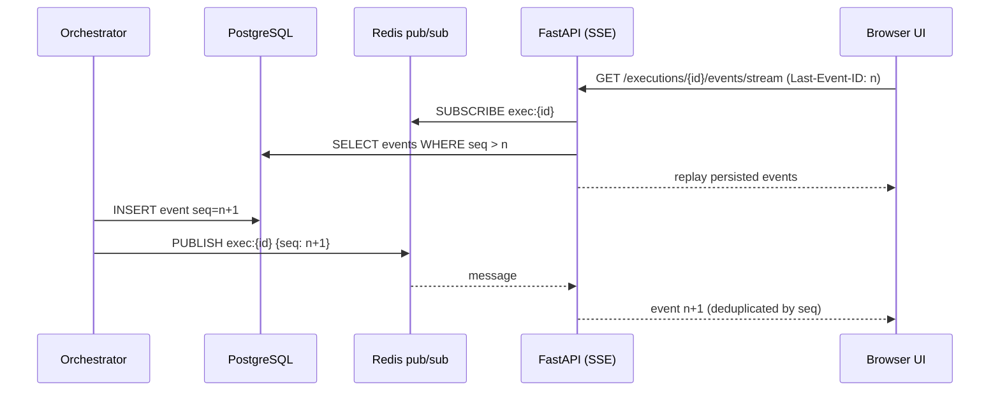

# Execution Center

> Status: event pipeline, SSE stream, run view with step screenshots and timeline
> **Implemented in Milestone 4** (see [BROWSER_EXECUTION.md](BROWSER_EXECUTION.md)); live
> workflow canvas, node inspector and throttled in-progress frames follow in Milestone 6.

## 1. Layout

```
┌───────────────────────────────────────────────┬──────────────────────┐
│ Workflow canvas (read-only, live node states) │ Node inspector       │
│                                               │  common / AI /       │
│                                               │  browser tabs        │
├───────────────────────────────────────────────┼──────────────────────┤
│ Live activity timeline (filters: AI, browser, │ Browser preview      │
│ errors, warnings, system)                     │ frame + step + time  │
└───────────────────────────────────────────────┴──────────────────────┘
```

## 2. Event pipeline



- Events are written to `execution_events` first (`seq` is unique per
  execution) and published afterwards. The API subscribes before replaying
  and deduplicates by `seq`, so no event is lost between replay and live tail.
- Transport is **Server-Sent Events** (one-way, built-in resume semantics).
  The SPA uses `fetch`-based SSE so the bearer token travels in a header, not
  a URL. Commands (cancel, approve) are normal REST calls.

## 3. Event schema

```json
{
  "id": "uuid", "execution_id": "uuid", "seq": 42,
  "ts": "2026-11-08T12:00:00.123Z",
  "type": "ai.request.completed",
  "category": "ai | browser | system | node",
  "level": "info | warning | error",
  "node_id": "optional", "node_execution_id": "optional",
  "message": "Provider response received from gemini/…",
  "data": { "redacted": "payload" }
}
```

Event types (initial): `execution.created`, `execution.validated`,
`execution.queued`, `execution.started`, `execution.completed`,
`execution.failed`, `execution.cancelled`, `node.queued`, `node.started`,
`node.retry_scheduled`, `node.completed`, `node.failed`, `node.skipped`,
`ai.request.started`, `ai.request.completed`, `ai.request.failed`,
`ai.fallback.applied`, `plan.validated`, `code.generated`,
`browser.worker.started`, `browser.navigation.completed`,
`browser.action.completed`, `browser.assertion.passed`,
`browser.assertion.failed`, `browser.console`, `browser.network.failed`,
`browser.frame`, `artifact.created`, `analysis.completed`,
`report.generated`.

## 4. Node inspector

- **Common:** name, type, node execution ID, status, start/end, duration,
  attempt/retry count, input/output validation results, errors, warnings.
- **AI nodes:** provider (labelled *external* or *local*), requested and
  actual model, task category, request metadata, sanitized prompt and response,
  token usage (when the provider returns it), latency, estimated cost (only
  when a dated, sourced price exists for that exact model — otherwise
  "unknown"), provider request ID, fallback/retry history.
- **Browser nodes:** engine, current URL, action/step, screenshots and
  artifacts, console messages, failed network requests, trace reference,
  duration and result.

## 5. Browser Preview

v1 (M6) uses **real screenshots, never a simulated view**:

- After every action the worker captures a screenshot (`browser.frame`
  event with step index, URL and capture timestamp).
- While an action is in progress (navigation, waits) the worker captures
  throttled frames (≤ 1 fps, JPEG) so the preview keeps moving.
- The preview shows the frame, the step being executed, the capture time and
  a "last updated Ns ago" indicator; a filmstrip allows scrubbing in
  historical runs.
- Frames are artifacts served through ownership-checked endpoints; password
  fields are masked in screenshots via Playwright's `mask` option.

Designed for later upgrade: Chromium CDP screencast frames relayed through
Redis to the SSE stream, with the same UI component. No debugging port or
remote-control interface is ever exposed to users.
