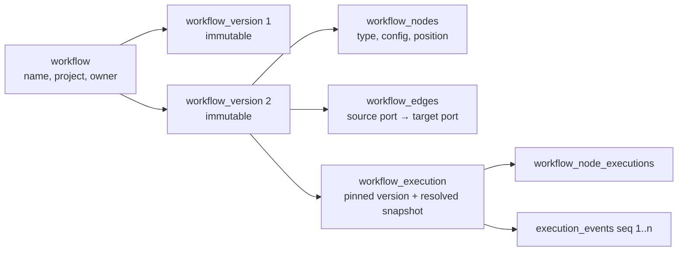
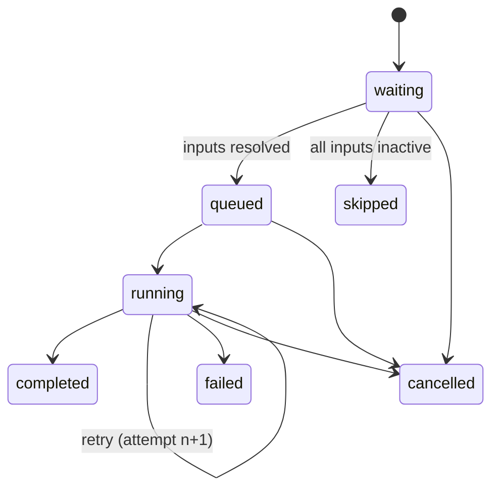

# Workflow Engine

> Status: **Implemented in Milestone 5** (engine, node registry, validation, Workflow
> Studio), reusing the browser worker from Milestone 4 and the AI router from Milestone 2.
> Deviations from the original design are marked *(v1)* below and in §7.

## 1. Model

- Saving in Workflow Studio creates a new immutable `workflow_version`.
  The workflow keeps a pointer to its latest version; duplicating copies the
  latest version into a new workflow.
- Starting an execution stores `workflow_version_id` plus a
  `resolved_snapshot` JSON: node configs after defaults, the AI routing that
  was resolved for every AI node, retry/timeout policies and the engine
  version. Execution never re-reads the editable workflow.

## 2. Node type contract

Every node type is a backend class registered in a `NodeRegistry`:

| Field | Purpose |
| --- | --- |
| `type_id` | Stable identifier, e.g. `browser.click`, `ai.test_planner`, `logic.condition` |
| `version` | Integer; configs are migrated when a type changes |
| `category` | `ai`, `browser`, `logic`, `data` |
| `config_schema` | Pydantic model → JSON Schema (drives the inspector form) |
| `inputs` / `outputs` | Named, typed ports (`session`, `test_plan`, `test_code`, `json`, `text`, `artifact`, `failure_report`, `any`) with Pydantic payload schemas |
| `validate(config, graph)` | Static rules beyond the schema (e.g. browser nodes need an upstream session) |
| `execute(ctx, inputs, config)` | Async implementation; returns outputs or raises a typed error |
| `error_behaviour` | Which errors are retryable (`TransientError`) vs permanent |
| `available` | `false` for planned nodes: shown greyed out, rejected by the validator |

The frontend never hardcodes node definitions; it renders the palette and the
inspector from `GET /api/v1/workflow-node-types`.

Initial node set (all listed in the brief). Availability is tracked in the
registry and in this table as nodes are implemented:

| Category | Node types |
| --- | --- |
| AI | Requirement Analyzer, Test Planner, Playwright Code Generator, Failure Analyzer, Visual Analyzer, Test Repair Proposal, Report Generator |
| Browser | Launch Browser, Navigate, Click, Fill Input, Select Option, Wait, Screenshot, Assert, Inspect Console, Inspect Network |
| Logic | Condition, Switch, Merge, Retry, Delay, Approval Gate |
| Data | Input, Transform Data, Validate Schema, Store Artifact, Output |

## 3. Validation (before save-as-runnable and before every run)

1. Every node type exists, is `available`, and its config passes its schema.
2. Every edge connects an output port to an input port of a compatible type
   (`any` accepts all). One edge per input port unless the port is
   `multi` (Merge).
3. Required input ports are connected.
4. The graph is acyclic (Kahn's algorithm). Loops are not supported in v1;
   retries are a node *policy*, not a back edge. The `Retry` logic node wraps
   a single downstream node's policy and does not create a cycle.
5. At least one entry node (an `Input` node or a node with no required
   inputs). Unreachable nodes produce warnings.
6. Browser nodes must be downstream of a `Launch Browser` node through
   `session` ports; a browser session cannot be shared across parallel
   branches unless they are serialised by the engine (see §4).
7. Navigation targets must match the project's allowed domains.

Validation returns structured issues `{node_id, edge_id, severity, code, message}`
that the canvas highlights.

## 4. Execution semantics

Each execution runs inside one orchestrator task (Celery), as an asyncio
scheduler.

**Readiness.** A node is ready when every incoming edge is *resolved*:
its source finished and the edge is either *active* (data flows) or
*inactive* (untaken branch / source skipped). If at least one incoming edge
is active the node runs; if all are inactive the node is `skipped` and its
outgoing edges become inactive (skip propagation). `Merge` nodes run when all
incoming edges are resolved and at least one is active (mode `all_active`) or
as soon as the first active input arrives (mode `first`).

**Ordering.** Independent ready nodes run concurrently up to
`max_parallel` (default 4). Ready nodes are started in topological order with
the node ID as tie-breaker, so event order is deterministic for a given
graph. Browser actions on the same session are serialised by a per-session
lock.

**Branches.** `Condition` evaluates a safe expression (a small whitelisted
expression language over the input JSON — no `eval`) and activates exactly
one of its `true`/`false` edges. `Switch` activates the first matching case or
`default`.

**Retries and timeouts.** Per node:
`retry: {max_attempts 1–5, backoff: fixed|exponential, base_seconds, max_seconds, retry_on: transient|any}`
and `timeout_seconds` per attempt. Only `TransientError`s (timeouts, HTTP
429/5xx from providers, navigation timeouts) are retried by default. Each
attempt is recorded and emits `node.retry_scheduled`. A workflow-level
timeout bounds the whole run.

**Failures.** If a node fails after its retries:
- if its `error` output handle is connected, the node is marked `failed`
  (handled), the error edge becomes active with the error payload, and the
  run continues;
- otherwise the run fails: running nodes are cancelled cooperatively, nodes
  not yet started become `skipped`, and the execution ends `failed`.

**Cancellation.** `POST /executions/{id}/cancel` sets the execution to
`cancelling` and a Redis cancel flag. The scheduler stops starting nodes,
cancels running tasks (AI requests are aborted; the browser worker aborts the
current action and closes the context), marks them `cancelled`, and ends the
run `cancelled`.

**Approval Gate.** Pauses the branch with execution status
`awaiting_approval` until a user approves/rejects via the API or the gate's
timeout elapses (configurable, then follows its `rejected`/`error` handle).

**Recovery.** The orchestrator heartbeats each running execution. If a
worker dies, a reaper marks the execution `failed` with reason
`worker_lost`. Side-effectful nodes (browser actions) are never replayed
automatically; the user can re-run.

**Data and validation.** Inputs are validated against the node's input schema
before `execute`, outputs against its output schema after. Validation results
are stored on the node execution and shown in the inspector. Payloads are
redacted before persistence.

## 5. Node and execution states

Execution states: `queued`, `running`, `awaiting_approval`, `cancelling`,
`completed`, `failed`, `cancelled`.

## 6. Events

Every transition emits an event (see [EXECUTION_CENTER.md](EXECUTION_CENTER.md))
persisted before it is published, so a historical run can be fully replayed.

## 7. What v1 implements (Milestone 5)

| Area | Implemented | Not yet |
| --- | --- | --- |
| Storage | `workflows`, immutable `workflow_versions` with the graph as one JSON document (ADR-019), `workflow_node_executions`; executions pin the version | — |
| Node types | Data: Input, Output · Browser: Launch Browser, Navigate, Click, Fill Input, Select Option, Press Key, Wait, Screenshot, Assert, Inspect Console, Inspect Network · Tests: Run Test (current approved version), Run Plan (validated against the project first) · AI: Requirement Analyzer, Test Planner · Logic: Condition, Merge, Delay | Code Generator, Failure Analyzer, Visual Analyzer, Repair Proposal, Report Generator (M7/M8), Switch, Approval Gate, Transform Data, Validate Schema, Store Artifact (shown as planned) |
| Browser nodes | Compile to one step of the test-plan DSL (same validation, secret rules and isolated worker as approved tests) | — |
| Validation | Rules 1–7 of §3; structured issues highlighted on the canvas; live while editing | — |
| Semantics | Readiness, skip propagation, deterministic ordering, `MAX_PARALLEL = 4`, per-session lock, retries with fixed/exponential backoff, per-attempt timeout, workflow time limit, `error` handles, cooperative cancellation | Merge mode `first`; `awaiting_approval`; heartbeats (stale runs are reported as interrupted after their time limit) |
| Condition | A closed set of operators over a dotted path into the input JSON (`equals`, `not_equals`, `contains`, `greater_than`, `less_than`, `exists`, `is_empty`); nothing is evaluated as code | Expression language |
| Events | `node.started/completed/failed/skipped/cancelled/retry_scheduled`, `ai.request.completed` (provider and actual model), browser events with `node_id` | `node.queued` |
| Studio | Palette from `GET /workflow-node-types`, drag and drop or click to add, typed connections (incompatible ones are refused), inspector generated from the config JSON Schema, retry/timeout editor, save version, duplicate, templates (Run a test, Generate and run with AI), run | Undo/redo, copy/paste of nodes |

